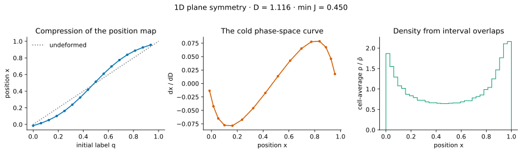
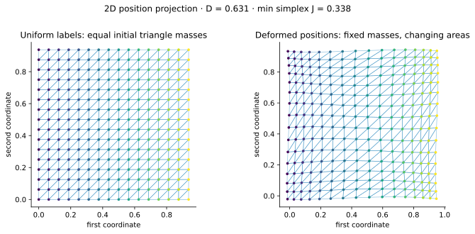
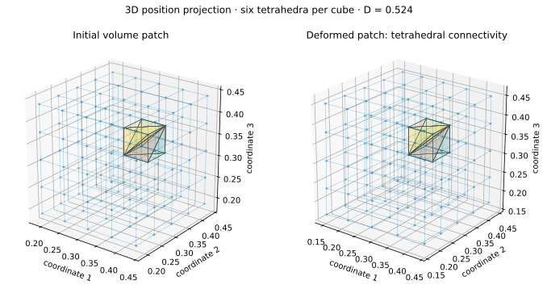

## Labels, positions, and velocities {#sec-sheet}

Let $\mathbf q$ label a fluid element in a periodic comoving box of side $L$. Choose these Lagrangian labels so the mass measure is uniform, $dm=\bar\rho_{\rm com}\,d^3q$. The element's comoving position is $\mathbf x(\mathbf q,a)=\mathbf q+\boldsymbol\Psi(\mathbf q,a)$. Its physical peculiar velocity is $\mathbf u=a\dot{\mathbf x}$, where dots denote cosmic time. The laboratory displays $\mathbf v_D=\partial\mathbf x/\partial D$; it is a growth derivative, not $\mathbf u$.

The cold phase-space distribution can be written as

$$
f(\mathbf x,\mathbf u,a)=\bar\rho_{\rm com}\int d^3q\,
\delta_{\rm D}^{(3)}[\mathbf x-\mathbf x(\mathbf q,a)]\,
\delta_{\rm D}^{(3)}[\mathbf u-\mathbf u(\mathbf q,a)].
$$ {#eq-cold-sheet}

A three-dimensional set of labels therefore specifies a three-dimensional manifold inside six-dimensional phase space. “Sheet” refers to this lower-dimensional manifold, not to a physically thin plane in ordinary space [@abel2012; @hahn2013]. The distribution has negligible primordial velocity dispersion in this idealization. Integrating over velocity gives the comoving mass density, not the physical density:

$$
\rho_{\rm com}(\mathbf x,a)=\int f(\mathbf x,\mathbf u,a)\,d^3u
=\bar\rho_{\rm com}\int d^3q\,\delta_{\rm D}^{(3)}[\mathbf x-\mathbf x(\mathbf q,a)].
$$ {#eq-pushforward-density}

The corresponding physical density is $\rho_{\rm phys}=a^{-3}\rho_{\rm com}$; the density contrast and the ratio $r=\rho/\bar\rho$ are unchanged by this common factor.

In one spatial dimension, draw the curve $(x(q),u(q))$ in a two-dimensional plot. In two dimensions, the sheet has two coordinates and lives in four-dimensional phase space; our triangular mesh is its **projection into position space**. In three dimensions, the tetrahedral mesh likewise displays the position-space projection of a three-dimensional sheet, rather than the full six-dimensional embedding. These projections make the deformation visible without pretending to show all phase-space coordinates at once.

{#fig-sheet1}

## Density is geometry {#sec-jacobian}

Define the deformation matrix $F_{ij}=\partial x_i/\partial q_j=\delta_{ij}+\Psi_{i,j}$ and its signed determinant $J=\det F$. Before first crossing, the map is one-to-one. Integrating @eq-cold-sheet over velocity, and changing variables from $\mathbf q$ to $\mathbf x$, then gives

$$
1+\delta[\mathbf x(\mathbf q,a),a]=\frac{1}{J(\mathbf q,a)}.
$$ {#eq-jacobian-density}

The determinant measures the ratio of current to initial comoving volume. Expansion of a patch gives a void; contraction gives an overdensity. Mass conservation is $r(\mathbf x)\,d^3x=d^3q$. There is no need to count randomly sampled particles to obtain this density.

The **first shell crossing** occurs when the map first loses local invertibility, $J=0$. After that event, different labels can reach the same position and the single-stream fluid equations cease to describe the full dynamics. The sheet itself does not disappear or lose its mass when its position-space projection folds. For a regular Eulerian point with several inverse images $\mathbf q_s$, the pushforward density is

$$
r(\mathbf x,a)=\sum_{\mathbf q_s:\,\mathbf x(\mathbf q_s,a)=\mathbf x}
\frac{1}{|J(\mathbf q_s,a)|}.
$$ {#eq-multistream-density}

The absolute value is essential: orientation records whether a local element has flipped, whereas mass density is nonnegative. At a caustic where $J=0$, the pointwise density can diverge; the singularity is interpreted through its locally integrable mass measure or through a finite-volume deposit. This equation describes the projection of a specified map. It is not a prescription for evolving the map once the single-stream gravitational equations fail. A truncated LPT displacement may still be evaluated algebraically after crossing, but that is a formal extrapolation and is not the post-crossing collisionless solution. A mathematical LPT series need not lose convergence at precisely the first crossing; its analytic singularities can occur later [@rampf2021]. In this laboratory, crossing is a validity diagnostic: all computed fields remain visible with a caution, while the validated LPT interpretation remains pre-crossing.

For a finite mesh, the relevant discrete counterpart is the signed ratio $J_T=V_T/V_{T,0}$ for every simplex. The live pre-crossing guard requires $J_T>0$ as well as positive spectral vertex Jacobians. These checks sample different representations of the map and should not be conflated. A plotted positive density after a fold would instead use $m_T/|V_T|$ for each simplex and add the contributions of all overlapping elements.

## An exactly solvable one-dimensional example {#sec-plane-wave}

For $\delta_0(q)=A\cos(kq)$, the growing plane-symmetric solution is

$$
x(q,D)=q-\frac{AD}{k}\sin(kq),\quad
\frac{\partial x}{\partial D}=-\frac{A}{k}\sin(kq),\quad
J(q,D)=1-AD\cos(kq).
$$ {#eq-plane-wave}

Zel'dovich's map [@zeldovich1970] is exact before crossing for plane-symmetric gravitational dynamics. Its first crossing is $D_{\rm sc}=1/A$ for $A>0$. Higher LPT terms vanish: a one-dimensional demonstration cannot validate the nonlinear 3D terms of 4LPT. Its value is that it provides an independent analytic benchmark for density, phase space, mass conservation, and N-body convergence.

For $\alpha=AD<1$, the Eulerian density along the map is

$$
r[x(q),D]=\frac{1}{1-\alpha\cos(kq)},\qquad
r_{\min}=\frac{1}{1+\alpha},\quad r_{\max}=\frac{1}{1-\alpha}.
$$ {#eq-plane-wave-density}

At $\alpha=1/2$, the single-stream density ranges from $2/3$ at the expanding crest to $2$ at the compressing crest. The Eulerian volume average is still one: $L^{-1}\int r(x)dx=L^{-1}\int dq=1$. As a second check, the mean density sampled by mass is $\langle r\rangle_M=\langle r^2\rangle_V=(1-\alpha^2)^{-1/2}$, obtained by integrating $(1-\alpha\cos kq)^{-1}$ uniformly over a period. It rises as crossing is approached because mass increasingly resides in a small Eulerian volume. At the limiting crossing $\alpha=1$, expanding near $q=0$ gives $x\sim k^2q^3/6$ and $J\sim k^2q^2/2$, hence $r(x)\propto |x|^{-2/3}$. The pointwise density diverges but is locally integrable and does not represent a finite Dirac mass at the caustic. This is a deterministic one-dimensional check, not a prediction for three-dimensional rare tails.

::: {.callout-tip title="Try it: a curve that compresses"}
Open the 1D experiment, vary the fraction of the crossing time, and compare the slope of $x(q)$ with the density. The phase-space curve is still unfolded in position. Verify that the high-density part corresponds to a small positive Jacobian. At fixed $A$, the plotted state has $AD=f$ for this preset; at $f=0.65$, the analytic maximum is $r_{\max}=1/(1-f)\simeq2.86$. Check that the finite cell averages peak below or near this value as the mesh resolves the crest.


:::

{#fig-sheet2}

## From elements to a finite sheet

Connect neighboring Lagrangian vertices with intervals (1D), two triangles per square (2D), or six consistently oriented Kuhn tetrahedra per cube (3D). Interpolate the **position and velocity maps** linearly in each simplex. An element then carries the fixed mass $m_T=\bar\rho_{\rm com}V_{T,0}$, and its pushforward density is constant: $\rho_T=m_T/|V_T|$. Before crossing the orientation agrees with its initial orientation.

Linear interpolation of the map is not the same as linear interpolation of density. The latter is an optional conservative reconstruction discussed in @sec-meshing. Keeping these two approximations distinct prevents an apparent improvement in interpolation from being mistaken for a change in gravitational dynamics.

::: {.callout-tip title="Try it: projections in two and three dimensions"}
Rotate the 3D mesh to see how its tetrahedra fill the volume. The 2D mesh provides a simpler view of neighboring elements. Both display connectivity that a scatter plot of particles hides.


:::

{#fig-sheet3}

These illustrations are reproducible with `scripts/render_figures.py` from the native laboratory response. They visualize the represented affine sheet; the mathematical density identity concerns the underlying one-to-one map. Open the full-resolution [1D](figures/sheet-1d.svg), [2D](figures/sheet-2d.svg), or [3D](figures/sheet-3d.svg) illustration to inspect the labels.

## Analysis exercises

1. **Pushforward density.** Starting from @eq-pushforward-density, use the multidimensional delta-function identity to derive @eq-jacobian-density for an invertible map. Then repeat the argument when there are several regular inverse images and explain why each contribution contains $|J_s|^{-1}$.
2. **Plane wave.** At $A D=1/2$, calculate the extrema of $J$, $r$, and the displacement gradient. Verify that the cell-integrated mass over one period is unchanged. Explain why the density divergence at $A D\to1$ does not imply a finite amount of mass concentrated at one point before crossing.
3. **Crossed projection.** Draw a folded one-dimensional map with three inverse images at a chosen $x$. Sum their positive $1/|dx/dq|$ contributions. Mark the sign of each derivative separately and explain why replacing the sum by the signed sum would violate mass positivity. State why this geometric construction alone does not supply post-crossing gravitational trajectories.
