## Overview: 40-Minute Seminar Structure {.unnumbered}

::: {.title-hero}
[The Pre-Crossed Phase-Space Sheet: Exact Lagrangian Geometry + 4LPT for Field-Level Cosmology]{.card-heading}


**Audience:** Perturbation Theory (PT), EFTofLSS & Field-Level Inference Cosmologists · **Interactive Deck:** Embedded React.js + Rust/Wasm (`hcc_core`) Panels
:::

::: {.slide-grid-3}
::: {.slide-card .blue}
[Act I: The Forward-Modeling Dilemma (8 min)]{.card-heading}


- Why field-level inference requires a hard UV cutoff $\Lambda$ (or $R_f$).
- How existing pipelines (`LEFTfield`, Shifted-EFT, `BORG`, `BORG-EM`, `LULO`, `Manticore`) trade off dynamics vs. particle discreteness.
- The $R_f \leftrightarrow \Lambda$ dictionary: why $R_f \sim 14\text{–}18\,h^{-1}\mathrm{Mpc}$ ($\Lambda \sim 0.12\text{–}0.16\,h\,\mathrm{Mpc}^{-1}$) is $>99.5\%$ single-stream at $z=0$.
:::

::: {.slide-card .accent}
[Acts II & III: Geometry & 4LPT Dynamics (21 min)]{.card-heading}


- Continuous Kuhn-simplex sheet ($P_{\mathrm{shot}} \equiv 0$, R3D voxelization, Hermite–Genocchi Fourier modes).
- 4LPT cofactor recursion, Cauchy vorticity invariant, 1-pt PDFs, and 2-pt spatial copulas.
- Exact parameter-free tidal shear law $F_M(>\bar\rho) = \frac{1}{2} + A_1\sigma + A_3\sigma^3$ verified across $1100\,(h^{-1}\mathrm{Gpc})^3$.
:::

::: {.slide-card .purple}
[Acts IV & V: Differentiable Inference (11 min)]{.card-heading}


- Space–time factorization of the 13 spatial 4LPT basis tensors $\mathbf{S}^\tau(\mathbf{q})$ on lightcones.
- Exact analytic confluent divided-difference JVPs $\partial I_T(\mathbf{k})/\partial\mathbf{x}_i$.
- Sub-percent BAO preservation ($0.12\%$ in 3D) and live React + WebAssembly panels built directly into these slides.
:::
:::

::: {.notes}
Welcome everyone. This 40-minute pedagogical seminar is designed for perturbation-theory, EFTofLSS, and field-level inference cosmologists. Several slides contain live React.js + Rust/WebAssembly panels running directly inside the browser.
:::

---

## Slide 1: The Field-Level Inference Bottleneck [Act I · 00:00–02:00]{.act-badge .act-1}

::: {.slide-grid-55-45}
::: {.slide-col}
::: {.slide-card .blue}
[Why Field-Level Inference (FLI) Beyond $P(k)$ and $B(k_1,k_2,k_3)$?]{.card-heading}


- Stage-IV surveys (DESI, Euclid, Rubin LSST, SPHEREx, Roman) map the full 3D non-Gaussian cosmic web—filaments, walls, and deep cosmic voids.
- Extracting that non-Gaussian information requires evaluating a differentiable forward model $\hat{\delta}_{\mathbf{k}}[\delta_{\mathrm{in}}]$ (and its Jacobian $\partial\hat{\delta}/\partial\delta_{\mathrm{in}}$) inside Hamiltonian Monte Carlo (HMC) or Simulation-Based Inference (SBI) loops:
  $$\ln\mathcal{P}(\delta_{\mathrm{in}}, \theta \mid \delta_{\mathrm{obs}}) = -\frac{1}{2}\sum_{\mathbf{k}} \frac{|\delta_{\mathrm{obs}}(\mathbf{k}) - \hat{\delta}_{\mathbf{k}}[\delta_{\mathrm{in}}, \theta]|^2}{\sigma_\epsilon^2(k)} - \frac{1}{2}\sum_{|\mathbf{q}|<\Lambda}\frac{|\delta_{\mathrm{in}}(\mathbf{q})|^2}{P_{\mathrm{lin}}(q)} + \mathrm{const.}$$
:::

::: {.slide-card .warn}
[The Dilemma Facing Every Existing Forward Model]{.card-heading}


- **Eulerian PT / EFTofLSS (`LEFTfield`):** Analytically clean & fast, but expands in $\delta(\mathbf{x})$—diverging in voids ($\delta \to -1$) and erasing large coherent displacements unless infrared-resummed.
- **Grid-Based LPT + CIC / PM $N$-Body (`BORG`):** Gets large-scale displacements right, but represents a continuous sheet as discrete point particles—polluting voids with empty cells ($\rho=0$) and high-$k$ with $1/\bar{n}$ shot noise!
:::
:::

::: {.slide-fig .tall}


::: {.slide-fig-caption}
**The Core Thesis:** Dark matter in the controlled UV-filtered regime ($\Lambda$ / $R_f$) is a smooth 3D submanifold $(\mathbf{q}, \mathbf{x}(\mathbf{q}), \mathbf{v}(\mathbf{q}))$ of 6D phase space—*not* a cloud of point particles.
:::
:::
:::

---

## Slide 2: What Existing Field-Level Pipelines Do (1/2) [Act I · 02:00–03:30]{.act-badge .act-1}

::: {.slide-grid-2}
::: {.slide-card}
[1. `LEFTfield` — Grid-Based $n$LPT + Eulerian Bias Expansion]{.card-heading}

*Schmidt, Elsner, Jasche, Nguyen, Kostić, Tucci, Stadler et al. (2019–2025)*

::: {.slide-grid-2}
::: {.slide-fig .compact}
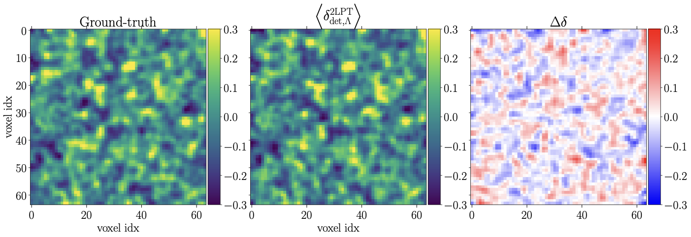

::: {.slide-fig-caption}
$\Lambda = 0.10\,h\,\mathrm{Mpc}^{-1}$ vs $N$-body (Schmidt+ 2019)
:::
:::

::: {.slide-fig .compact}
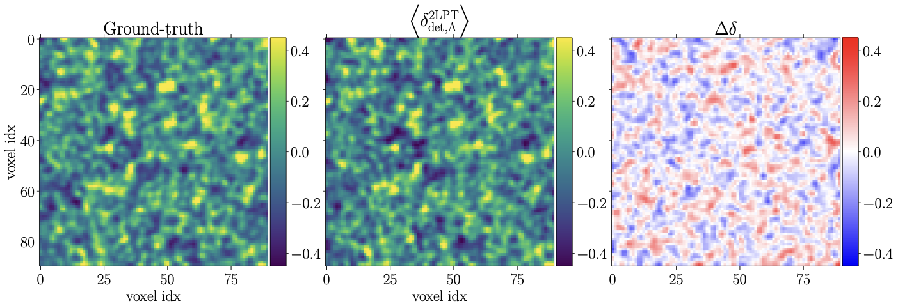

::: {.slide-fig-caption}
$\Lambda = 0.14\,h\,\mathrm{Mpc}^{-1}$: UV residuals grow
:::
:::
:::

- Applies a sharp spherical cutoff $W_\Lambda(\mathbf{k}) = \Theta(\Lambda - |\mathbf{k}|)$ at $\Lambda \sim 0.10\text{–}0.20\,h\,\mathrm{Mpc}^{-1}$, evaluates $n$LPT on a padded cubic grid, and constructs Eulerian bias operators $\mathcal{O}(\mathbf{x})$ at $\Lambda' \ge \Lambda$.
- **Why they switched from Eulerian grid Jacobian to CIC (2021):** Evaluating $\delta = |\mathbf{I}+\mathbf{M}|^{-1}-1$ on the Eulerian grid became numerically unstable near shell crossing, so `LEFTfield` switched to displacing pseudo-particles + CIC assignment (introducing the CIC window and discreteness noise).
:::

::: {.slide-card}
[2. Shifted-Operator EFT / Lagrangian IR Resummation]{.card-heading}

*Schmittfull, Simonović, Assassi, Zaldarriaga (2019) & Ivanov et al. (2024)*

::: {.slide-grid-2}
::: {.slide-fig .compact}
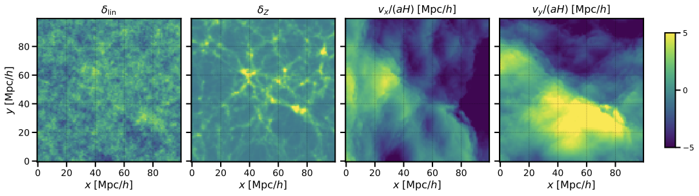

::: {.slide-fig-caption}
CIC-deposited Zel'dovich shifted operators $\tilde{\mathcal{O}}_i(\mathbf{x})$
:::
:::

::: {.slide-fig .compact}
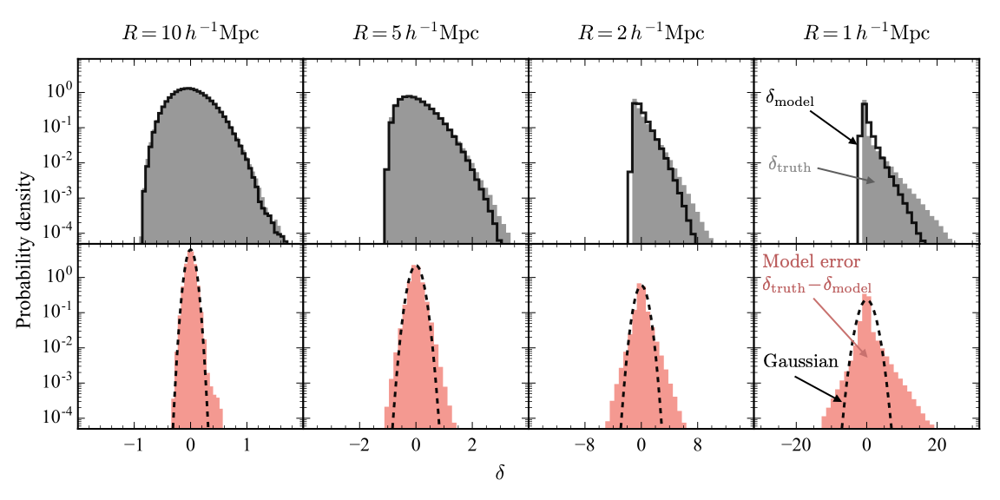

::: {.slide-fig-caption}
1-pt PDF at $R = 5\,h^{-1}\mathrm{Mpc}$ across $z$
:::
:::
:::

- Displaces uniform grid points by $\boldsymbol{\Psi}_1(\mathbf{q}) = \int_{|\mathbf{k}|<\Lambda} \frac{i\mathbf{k}}{k^2}\delta_1(\mathbf{k})e^{i\mathbf{k}\cdot\mathbf{q}}$ and deposits them with **CIC** onto an Eulerian mesh:
  $$\tilde{\mathcal{O}}_n(\mathbf{k}) = \int d^3q\,\mathcal{O}_n(\mathbf{q})\,e^{-i\mathbf{k}\cdot(\mathbf{q}+\boldsymbol{\Psi}_1(\mathbf{q}))}$$
- Matches 1-loop $P(k)$ & $B(k)$ because orthogonalized transfer functions $b_i(k)$ absorb CIC window & shot noise in 2-pt space—**but raw real-space voids and high-$k$ phases remain particle-discretized!**
:::
:::

---

## Slide 3: What Existing Field-Level Pipelines Do (2/2) [Act I · 03:30–05:00]{.act-badge .act-1}

::: {.slide-grid-3}
::: {.slide-card}
[3. `BORG` (2LPT / PM / tCOLA + CIC)]{.card-heading}

*Jasche & Wandelt (2013); Lavaux & Jasche (2016); Leclercq et al. (2020)*

::: {.slide-fig .compact}
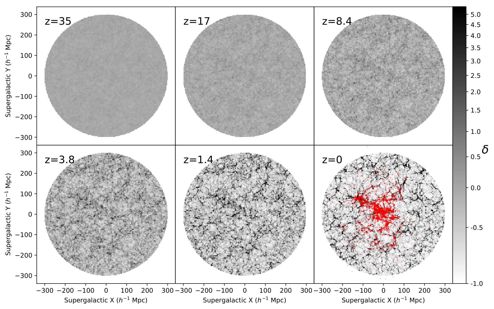

::: {.slide-fig-caption}
`BORG-PM` Supergalactic plane (Lavaux & Jasche 2016)
:::
:::

- `BORG-2LPT` / `BORG-PM` ($128^3\text{–}256^3$, $\Delta x \sim 2.6\text{–}4\,h^{-1}\mathrm{Mpc}$) uses differentiable **CIC** particle assignment inside HMC.
- Smooth enough for gradients, but voids suffer from $1/\bar{n}$ particle shot noise and zero-density cells.
:::

::: {.slide-card}
[4. `BORG-EM` & `LULO` (Emulator in HMC)]{.card-heading}

*Doeser, Jamieson, Stopyra, Lavaux, Leclercq, Jasche (2024, 2025)*

::: {.slide-fig .compact}
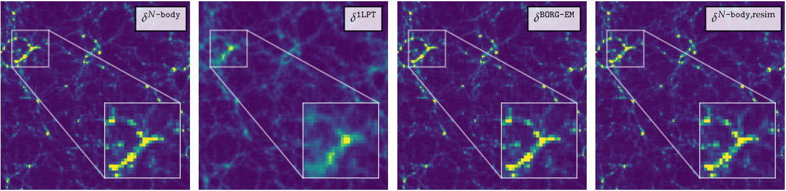

::: {.slide-fig-caption}
`BORG-EM` neural displacement emulator vs 10-step COLA & $N$-body
:::
:::

- Replaces 2LPT/tCOLA inside HMC with a 3D CNN displacement emulator trained on `Gadget-4` (correcting $N$-body displacements to $\sim 1\%$ at $k \le 0.4\,h\,\mathrm{Mpc}^{-1}$).
- Still deposits discrete particles onto the Eulerian grid via **CIC**!
:::

::: {.slide-card}
[5. `Manticore-Local` (2025) & HMC vs. SBI (2026)]{.card-heading}

*McAlpine et al. (2025); Doeser, Leclercq et al. (2026)*

::: {.slide-fig .compact}
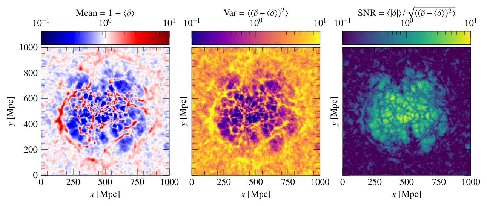

::: {.slide-fig-caption}
`Manticore-Local` $256^3$ 2M++ inference ($\Delta x = 3.9\,h^{-1}\mathrm{Mpc}$)
:::
:::

- `Manticore-Local` inferences at $N=256^3$ still rely on CIC during HMC and require re-simulating with `Swift` $N$-body at $1024^3$ afterward.
- **What if the forward model inside inference already had exact continuous sheet geometry + 4LPT?**
:::
:::

---

## Slide 4: Why Eulerian PT Struggles while Lagrangian PT Stays Controlled [Act I · 05:00–06:30]{.act-badge .act-1}

::: {.slide-grid-2}
::: {.slide-card .blue}
[Eulerian vs. Lagrangian Expansion Variable]{.card-heading}


- **Eulerian Perturbation Theory (EPT)** expands in the density contrast $\delta(\mathbf{x}, t) = \rho(\mathbf{x},t)/\bar\rho - 1$:
  - A bulk flow $\mathbf{x} = \mathbf{q} + \boldsymbol{\Psi}_{\mathrm{IR}}$ changes Eulerian phases by $\mathcal{O}(\mathbf{k}\cdot\boldsymbol{\Psi}_{\mathrm{IR}} \gg 1)$ without changing local dynamics—requiring explicit IR resummation.
  - In voids ($\delta \to -1$) and filaments ($\delta \gtrsim 2$), Taylor series in $\delta$ fail to converge; cumulant expansions can even predict unphysical $\rho < 0$.
- **Lagrangian Perturbation Theory (LPT)** expands the trajectory map $\mathbf{x}(\mathbf{q}, a) = \mathbf{q} + \boldsymbol{\Psi}(\mathbf{q}, a)$:
  - Mass conservation is **exact and non-perturbative in $\delta$**:
    $$1 + \delta(\mathbf{x}(\mathbf{q}, a)) = \frac{1}{J(\mathbf{q}, a)}, \qquad J(\mathbf{q}, a) \equiv \det\!\bigl[\mathbf{I} + \nabla_{\mathbf{q}}\boldsymbol{\Psi}(\mathbf{q}, a)\bigr]$$
  - Even a gentle $30\%$ Lagrangian stretching ($J \approx 2.2$) produces a deep nonlinear void ($\delta \approx -0.55$) smoothly and with guaranteed positivity $\rho > 0$!
:::

::: {.slide-card .accent}
[The Exact Mathematical Condition for Single-Stream Validity]{.card-heading}


- The map $\mathbf{q} \mapsto \mathbf{x}(\mathbf{q}, a)$ is a smooth diffeomorphism on $\mathbb{T}^d$ if and only if:
  $$J(\mathbf{q}, a) = \det\!\left(\delta_{ij} + \frac{\partial\Psi_i(\mathbf{q}, a)}{\partial q_j}\right) > 0 \quad \forall\,\mathbf{q} \in \mathbb{T}^d$$
- **First shell crossing** occurs at the earliest scale factor $a_{\times}$ where $\min_{\mathbf{q}} J(\mathbf{q}, a_{\times}) = 0$ (a pancake fold caustic where one eigenvalue of $\nabla_{\mathbf{q}}\boldsymbol{\Psi}$ reaches $-1$).
- Before $a_{\times}$:
  1. Single-stream pressureless fluid equations are **exact** (zero multi-stream velocity dispersion $\sigma_{ij} \equiv 0$).
  2. Kelvin's circulation theorem guarantees $\nabla_{\mathbf{x}} \times \mathbf{u} = \mathbf{0}$ everywhere.
  3. The phase-space sheet never tears or self-intersects—and 4LPT converges rapidly!
:::
:::

---

## Slide 5: The UV Cutoff Dictionary ($R_f \leftrightarrow \Lambda$) & Pre-Crossed Regime [Act I · 06:30–08:00]{.act-badge .act-1}

::: {.slide-grid-55-45}
::: {.slide-card}
[Translating Gaussian Smoothing $R_f$ to Sharp-$k$ Cutoff $\Lambda$]{.card-heading}


Every EFT/FLI pipeline regularizes initial UV modes with either a sharp-$k$ filter $\Theta(\Lambda - k)$ or a Gaussian filter $W_G(k R_f) = \exp(-\frac{1}{2}k^2 R_f^2)$. Matching the variance of the displacement gradient tensor $\sigma^2(\nabla\boldsymbol{\Psi})$ gives $\Lambda_{\mathrm{eff}} \simeq \sqrt{5}/R_f \approx 2.24/R_f$ (or half-power $k_{1/2} = \sqrt{\ln 2}/R_f \approx 0.83/R_f$):

| Gaussian $R_f$ [$h^{-1}\mathrm{Mpc}$] | Sharp-$k$ $\Lambda_{\mathrm{eff}}$ [$h\,\mathrm{Mpc}^{-1}$] | Linear $\sigma(R_f, z=0)$ | Uncrossed Mass Fraction ($z=0$) | Physical Regime at $z=0$ |
| :---: | :---: | :---: | :---: | :--- |
| **$18$** | $\sim 0.12$ | $0.259$ | **$99.96\%$** | Almost purely pre-crossed ($\sim 4\times 10^{-4}$ crossed) |
| **$14$** | $\sim 0.16$ | $0.326$ | **$99.51\%$** | Controlled pre-crossed benchmark (`LEFTfield` $\Lambda=0.14$) |
| **$10$** | $\sim 0.22$ | $0.422$ | **$97.54\%$** | Mild localized filament crossing (`LEFTfield` $\Lambda=0.20$) |
| **$6$** | $\sim 0.37$ | $0.581$ | **$99.1\%$** ($a=0.58$) / $91\%$ ($z=0$) | High-$z$ DESI/Euclid regime ($z \gtrsim 0.7$) |
:::

::: {.slide-card .warn}
[Where Does $1\%$ Shell Crossing Occur in Planck $\Lambda$CDM?]{.card-heading}


- Across our $1100\,(h^{-1}\mathrm{Gpc})^3$ suite (`DiscoDJ.jl/studies/mass_cdf`), the crossed mass fraction $f_\times = P(J \le 0)$ follows an exponential rare-event law in $1/\sigma^2$:
  - $\sigma = 0.26$ ($R_f = 18\,h^{-1}\mathrm{Mpc}$): $f_\times = 4.2 \times 10^{-4}$ ($0.04\%$)
  - $\sigma = 0.33$ ($R_f = 14\,h^{-1}\mathrm{Mpc}$): $f_\times = 4.9 \times 10^{-3}$ ($0.49\%$)
  - $\sigma = 0.58$ ($R_f = 6\,h^{-1}\mathrm{Mpc}$ at $z\approx 0.7$): $f_\times = 8.9 \times 10^{-3}$ ($0.89\%$)
- **Crucial insight for EFT/FLI cosmologists:** At the UV cutoffs $\Lambda \sim 0.10\text{–}0.16\,h\,\mathrm{Mpc}^{-1}$ already used in `LEFTfield` and `BORG`, **$>99.5\%$ of the universe is still in the single-stream pre-crossed regime at $z=0$** (and down to $R_f \sim 6\,h^{-1}\mathrm{Mpc}$ at $z \ge 1$)!
:::
:::

---

## Slide 6: Why Particle Assignment Fails Even Before Shell Crossing [Act II · 08:00–10:00]{.act-badge .act-2}

::: {.slide-grid-45-55}
::: {.slide-card .warn}
[The Hidden Discretization Bug in Standard Pipelines]{.card-heading}


- Suppose $J(\mathbf{q}, a) > 0$ everywhere—the physics is 100% single-stream and smooth.
- Standard pipelines discard the Lagrangian connectivity and treat vertices $\mathbf{x}_{\mathbf{i}}$ as point particles deposited with NGP, CIC, or TSC:
  $$\rho_C^{\mathrm{CIC}} = \frac{1}{\Delta x^d}\sum_p m_p W_{\mathrm{CIC}}(\mathbf{x}_p - \mathbf{x}_C)$$
- In an expanding void where $J = 4$, inter-vertex spacing grows by $4^{1/3} \approx 1.6\times$. Whenever Eulerian cell size $\Delta x_{\mathrm{mesh}} \lesssim \Delta x_{\mathrm{void}}$, particles separate farther than the kernel support:
  - **Voids shatter into artificial empty cells ($\rho_C = 0$, $\delta_C = -1$)!**
  - Log-density likelihoods $\ln(1+\delta)$ diverge!
  - High-$k$ power is swamped by white shot noise $P_{\mathrm{shot}} = L^3/N_p$ convolved with $\operatorname{sinc}^{2p}(k\Delta x/2)$.
:::

::: {.slide-fig .tall}
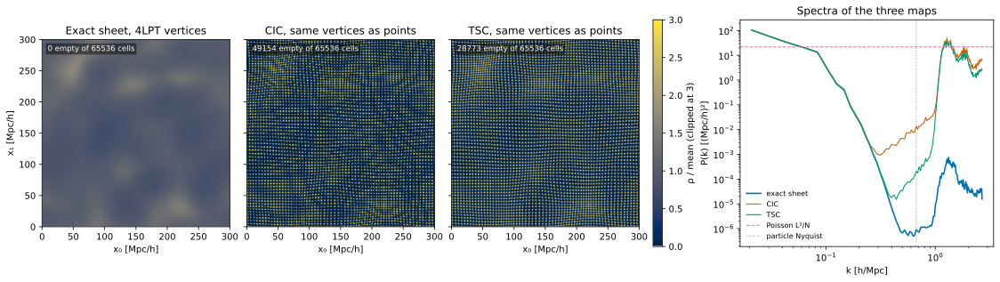

::: {.slide-fig-caption}
**Same 4LPT vertex trajectories, different density estimators:** When $M > N$, CIC breaks the continuous sheet into isolated spikes separated by artificial vacuum ($\rho = 0$), whereas the continuous sheet ($P_0$ and $P_1$) remains strictly positive and smooth everywhere.
:::
:::
:::

---

## Slide 7: The Simplicial Phase-Space Sheet & Exact R3D Voxelization [Act II · 10:00–12:30]{.act-badge .act-2}

::: {.slide-grid-2}
::: {.slide-card .accent}
[Kuhn Freudenthal Triangulation & Exact Clipping]{.card-heading}


- Partition each Lagrangian cell $[\mathbf{i}, \mathbf{i}+\mathbf{1}]\Delta q$ into $d!$ simplices indexed by permutations $\pi \in S_d$ ($2$ triangles per cell in 2D; $6$ tetrahedra per cell in 3D, Total $= 6 N^3$).
- Each simplex $T$ carries exact conserved mass $m_T = \bar\rho\,(\Delta q)^d / d!$ and deformed signed volume:
  $$V_T = \frac{1}{d!}\det\bigl[\mathbf{x}_1 - \mathbf{x}_0,\;\dots,\;\mathbf{x}_d - \mathbf{x}_0\bigr], \qquad \rho_T = \frac{m_T}{|V_T|} > 0$$
- **Piecewise-Constant Sheet ($P_0$, Powell & Abel 2015 `R3D`):** Clip each simplex $T$ against the $2d$ bounding half-spaces of each Eulerian cell $C$ via Sutherland–Hodgman / R3D convex polytope clipping:
  $$\rho_C^{(P_0)} = \frac{1}{|C|}\sum_{T} \rho_T\,\operatorname{Vol}(T \cap C), \qquad \sum_C \rho_C^{(P_0)} |C| = M_{\mathrm{tot}} \text{ (to } 10^{-15}\text{)}$$
- **Piecewise-Linear Sheet ($P_1$):** Evaluate exact nodal Jacobians $J_a$ at vertices, form $\rho_a = \bar\rho / J_a$, and integrate the barycentric linear field across $T \cap C$ using the exact centroid $\bar{\mathbf{x}}_{T\cap C}$.
:::

::: {.slide-col}
::: {.slide-fig}


::: {.slide-fig-caption}
**3D $\Lambda$CDM Benchmark ($L = 500\,h^{-1}\mathrm{Mpc}$):** 6 Kuhn tetrahedra tile every Lagrangian cell without gaps or overlaps.
:::
:::

::: {.slide-card .blue}
[Quantitative Payoff ($64^3$ vs $256^3$ Reference)]{.card-heading}


- On a $64^3$ grid deposited onto a $128^3$ mesh, **CIC leaves $66.3\%$ of all Eulerian cells completely empty ($\rho = 0$)** and has a $>500\%$ density quantile error.
- From the **exact same $64^3$ 4LPT vertices**, the $P_0$ / $P_1$ sheet has **$0.0\%$ empty cells** and matches the $256^3$ reference density distribution to **$1.6\%$**!
:::
:::
:::

---

## Slide 8: Live React Panel 1 — Trajectories $\times$ Estimators & Log-Density Maps [Act II · 12:30–14:30]{.act-badge .act-2}

```{=html}
<div class="react-slide-lab-mount" data-panel="estimator-density"></div>
```

---

## Slide 9: Continuous Mesh-Free Fourier Modes via Hermite–Genocchi Divided Differences [Act II · 14:30–16:30]{.act-badge .act-2}

::: {.slide-grid-2}
::: {.slide-card .accent}
[Exact Fourier Transform of a Deformed Simplex (No Grid!)]{.card-heading}


- Can we compute the Fourier mode $\delta^{\mathrm{sheet}}(\mathbf{k})$ of the piecewise-constant sheet **directly from the vertex coordinates $\mathbf{x}_0, \dots, \mathbf{x}_d$ without any Eulerian grid or FFT**?
- Map $T$ to the unit reference simplex $\Delta^d = \{\mathbf{u} \ge 0 : \sum_{j=1}^d u_j \le 1\}$ via $\mathbf{x}(\mathbf{u}) = \mathbf{x}_0 + \sum_{j=1}^d u_j(\mathbf{x}_j - \mathbf{x}_0)$. Since $\rho_T V_T = m_T$, the geometric Jacobian $d!\,V_T$ cancels $\rho_T$:
  $$I_T(\mathbf{k}) = \int_T \rho_T\,e^{-i\mathbf{k}\cdot\mathbf{x}}\,d^d x = m_T\,d!\int_{\Delta^d} \exp\!\left(s_0 + \sum_{j=1}^d u_j(s_j - s_0)\right) d^d u$$
  where $s_j \equiv -i\mathbf{k}\cdot\mathbf{x}_j$ are the pure imaginary vertex phases.
- By the **Hermite–Genocchi theorem**, this integral is the $d$-th divided difference of $\exp$:
  $$\boxed{I_T(\mathbf{k}) = m_T\,d!\,\exp[s_0, s_1, \dots, s_d]}, \qquad \delta^{\mathrm{sheet}}(\mathbf{k}) = \frac{1}{\bar\rho L^d}\sum_T I_T(\mathbf{k}) - \delta_{\mathbf{k},\mathbf{0}}$$
:::

::: {.slide-card .blue}
[Removable Coincident-Phase Singularities & Zero Shot Noise]{.card-heading}


- Explicitly in 1D ($d=1$) and 2D ($d=2$):
  $$\exp[s_0, s_1] = \frac{e^{s_1} - e^{s_0}}{s_1 - s_0}, \qquad 2!\,\exp[s_0, s_1, s_2] = 2\sum_{a=0}^2 \frac{e^{s_a}}{\prod_{b\neq a}(s_a - s_b)}$$
- When a wavevector $\mathbf{k}$ is nearly orthogonal to a simplex edge ($|s_a - s_b| \ll 1$), naive subtraction suffers catastrophic cancellation.
- In `observables.rs` (and our WebGPU WGSL kernel), we sort arguments so $|s_i - s_j|$ is minimal and replace small differences by a 12-term Horner Taylor series of the confluent divided difference—giving **machine precision ($\sim 10^{-15}$) across all wavevectors**!
- **No grid aliasing, no assignment window $\operatorname{sinc}(k\Delta x/2)$, and $P_{\mathrm{shot}} \equiv 0$!**
:::
:::

---

## Slide 10: Live React Panel 2 — 16-Ray Brillouin-Zone Simplex Spectrum & Nonlinear Transfer [Act II · 16:30–18:00]{.act-badge .act-2}

```{=html}
<div class="react-slide-lab-mount" data-panel="simplex-spectra"></div>
```

---

## Slide 11: Building the Sheet with 4LPT — Cofactor Recursion & Cauchy Curl Invariant [Act III · 18:00–20:00]{.act-badge .act-3}

::: {.slide-grid-2}
::: {.slide-card}
[Why LPT is Purely Polynomial (Matsubara 2015; Rampf+ 2012)]{.card-heading}


- Transforming the Euler–Poisson divergence equation to $\mathbf{q}$-space via the cofactor matrix $C_{ij} = \partial J/\partial F_{ij} = J(F^{-1})_{ji}$ **cancels the $1/J$ chain-rule factor against the $J$ in $\rho/\bar\rho - 1 = 1/J - 1$**:
  $$C_{ij}\left(\frac{d^2}{dt^2} + 2H\frac{d}{dt}\right)\Psi_{i,j} = \frac{3}{2}\Omega_m(a)H(a)^2 (J - 1)$$
- Expanding $J - 1 = \operatorname{tr}\mathbf{M} + \mu_2(\mathbf{M},\mathbf{M}) + \mu_3(\mathbf{M},\mathbf{M},\mathbf{M})$ in symmetric invariant polynomials $\mu_2(\mathbf{A},\mathbf{B}) = \frac{1}{2}(\operatorname{tr}\mathbf{A}\operatorname{tr}\mathbf{B} - \operatorname{tr}(\mathbf{A}\mathbf{B}))$ gives closed longitudinal recursions at every order $n=1,2,3,4$.

[The Transverse Piece: Cauchy Vorticity Invariant at $n \ge 3$]{.card-heading}


- Eulerian irrotationality ($\nabla_{\mathbf{x}}\times\mathbf{u} = \mathbf{0}$) in Lagrangian coordinates reads $\epsilon_{ijk}F_{lj}\dot{F}_{lk} = 0$, which **forces a non-zero Lagrangian curl starting at 3LPT**:
  $$\nabla_{\mathbf{q}} \times \boldsymbol{\Psi}^{(3)} = -\frac{1}{3}\epsilon_{ijk}\Psi_{l,j}^{(1)}\Psi_{l,k}^{(2)} \neq \mathbf{0}$$
- At **4LPT**, this 3LPT magnetic-type curl couples back into the longitudinal displacement divergence!
:::

::: {.slide-card .blue}
[Exact Coupled $\Lambda$CDM Growth ODEs & Space–Time Factorization]{.card-heading}


- In exact $\Lambda$CDM (`growth.rs` & `DiscoDJ.jl`), different spatial vertices evolve with distinct coupled growth functions $g_\tau(a)$ solving $\mathcal{L}_a g_\tau \equiv g_\tau'' + \bigl(\frac{3}{a} + \frac{E'}{E}\bigr)g_\tau' - \frac{3\Omega_{m,0}}{2a^5 E^2}g_\tau = S_\tau(a)$:
  - $n=1$: $D_1(a)$ (1 spatial gradient field)
  - $n=2$: $D_2(a) \approx -\frac{3}{7}\Omega_m^{-1/143} D_1^2$ (1 quadratic field $\mu_2(\mathbf{M}^{(1)},\mathbf{M}^{(1)})$)
  - $n=3$: $D_{3a}, D_{3b}, D_{3c}$ (cubic determinant $\mu_3$, rescattered $\mu_2(\mathbf{M}^{(1)},\mathbf{M}^{(2)})$, and transverse curl)
  - $n=4$: 6 longitudinal channels $D_{4a}\dots D_{4f}$ + 2 transverse channels
- **Space–Time Factorization Advantage:** All 13 spatial basis fields $\mathbf{S}^\tau(\mathbf{q})$ depend *only* on the initial conditions $\delta_0(\mathbf{q})$. Evaluating the sheet at any redshift $z$ or growth history on a lightcone is an instant linear combination $\boldsymbol{\Psi}(\mathbf{q}, a) = \sum_\tau g_\tau(a)\mathbf{S}^\tau(\mathbf{q})$!
:::
:::

---

## Slide 12: Study 1 (`DiscoDJ.jl`) — One-Point Volume & Mass PDFs ($1\text{LPT}\to 4\text{LPT}$ vs $N$-Body) [Act III · 20:00–22:00]{.act-badge .act-3}

::: {.slide-grid-55-45}
::: {.slide-card}
[Isolating Trajectory Error from Estimator Error (`studies/lpt_pdf`)]{.card-heading}


In both `precrossedsheet` and `DiscoDJ.jl` ($L=300\,h^{-1}\mathrm{Mpc}$, $R_f = 14\,h^{-1}\mathrm{Mpc}$, $z=0$), we evolve the vertices with 1–4LPT and with a full $N$-body solver, keeping the **same Kuhn tetrahedral sheet connectivity** on both so any difference is pure dynamics:

| Smoothing $R_s$ [$h^{-1}\mathrm{Mpc}$] | Observable / Metric | 1LPT (Zel'dovich) | 2LPT | 3LPT | **4LPT** |
| :---: | :--- | :---: | :---: | :---: | :---: |
| **$7$ ($\frac{1}{2}R_f$)** | Variance $\sigma^2/\sigma^2_{\mathrm{NB}} - 1$ | $-18.3\%$ | $-9.4\%$ | $-4.0\%$ | **$-2.6\%$** |
| **$7$ ($\frac{1}{2}R_f$)** | Vol $0.1\% / 99.9\%$ quantiles | $-19.7\% / -26.4\%$ | $+10.8\% / -10.8\%$ | $-6.3\% / -5.1\%$ | **$+4.3\% / -2.8\%$** |
| **$14$ ($R_f$)** | Variance $\sigma^2/\sigma^2_{\mathrm{NB}} - 1$ | $-9.1\%$ | $-5.0\%$ | $-1.4\%$ | **$-0.9\%$** |
| **$14$ ($R_f$)** | Mass $99\% / 99.9\%$ quantiles | $-19.2\% / -23.0\%$ | $-7.5\% / -9.1\%$ | $-3.5\% / -4.2\%$ | **$-1.9\% / -2.4\%$** |
| **$28$ ($2R_f$)** | Max $|\text{quantile shift}|$ | $9.3\%$ | $2.8\%$ | $1.1\%$ | **$0.5\%$** |
| **$42$ ($3R_f$)** | Max $|\text{quantile shift}|$ | $5.1\%$ | $1.3\%$ | $0.3\%$ | **$0.1\%$** |
:::

::: {.slide-card .accent}
[Two Dual Measures of Cosmic Structure]{.card-heading}


- **Volume-Weighted PDF $p_V(r)$ ($r \equiv \rho/\bar\rho$):** Weights each simplex by its deformed Eulerian volume $V_T \propto J_T$—dominated by expanding **cosmic voids** ($r \ll 1$).
  - Notice the alternating-sign asymptotic convergence in the deep void tail ($0.1\%$ quantile): $-19.7\% \to +10.8\% \to -6.3\% \to \mathbf{+4.3\%}$.
- **Mass-Weighted PDF $p_M(r) = r\,p_V(r)$:** Weights each simplex equally by its conserved Lagrangian mass $m_T$—sensitive to collapsing **filaments, walls, and peaks** ($r > 1$).
  - Monotonic convergence in the dense tail: $-23.0\% \to -9.1\% \to -4.2\% \to \mathbf{-2.4\%}$ at $R_s = R_f$.
- **Takeaway:** 2LPT is too narrow in both tails; at $R_s \ge R_f$, **4LPT reproduces the full non-Gaussian $N$-body 1-point PDF to $\lesssim 1\%$!**
:::
:::

---

## Slide 13: Live React Panel 3 — 1LPT $\to$ 4LPT vs. PM Sheet ($\sigma^2(R)$ & One-Point PDFs) [Act III · 22:00–23:30]{.act-badge .act-3}

```{=html}
<div class="react-slide-lab-mount" data-panel="lpt-convergence-variance-pdf"></div>
```

---

## Slide 14: Study 2 (`DiscoDJ.jl`) — Separating the Spatial Copula from the 1-Point PDF [Act III · 23:30–25:00]{.act-badge .act-3}

::: {.slide-grid-2}
::: {.slide-card .blue}
[How Do We Separate 1-Point Non-Gaussianity from Spatial Geometry?]{.card-heading}


- Two fields can have the exact same 1-point PDF $p_V(\rho)$ but different spatial clustering $\xi(r)$, or identical rank-ordered spatial structure (copula) with slightly different 1-point tails.
- **Rank-Gaussianization Test (`studies/lpt_pdf/copula`):**
  1. Sort the single-stream tetrahedral densities $\rho_T = \bar\rho / J_T$ across the volume.
  2. Map each element's rank $R_i \in \{1,\dots,N\}$ to a unit Gaussian score:
     $$y(\mathbf{q}_i) = \Phi^{-1}\!\left(\frac{R_i - 1/2}{N}\right), \qquad y \sim \mathcal{N}(0, 1)$$
  3. By construction, 1LPT, 2LPT, 3LPT, 4LPT, and $N$-body now have the **exact same unit-Gaussian 1-point PDF**! Any remaining difference in $\xi_y(r)$ or cross-correlation $r_y(k)$ is pure **spatial copula error**.
:::

::: {.slide-card .accent}
[What the Copula Decomposition Reveals]{.card-heading}


- **Result 1 — 2LPT Has a Real Copula Residual that 4LPT Eliminates:**
  - Even after equalizing the 1-point PDF, 2LPT exhibits a converged two-point copula residual $\Delta\xi_y = \xi_y^{\mathrm{LPT}} - \xi_y^{\mathrm{NB}} \approx 5.7\times 10^{-3}$ at $r = 20\text{–}30\,h^{-1}\mathrm{Mpc}$ ($z=0$).
  - **3LPT and 4LPT remove $75\%\text{–}95\%$ of this 2LPT copula error!**
  - Why? Because the 3LPT Cauchy vorticity curl $\nabla_{\mathbf{q}}\times\boldsymbol{\Psi}^{(3)}$ and 4LPT tidal rescattering rotate and shear filament/wall alignments into their true $N$-body geometry.
- **Result 2 — Where $N$-Body Differs at $r \sim 10\,h^{-1}\mathrm{Mpc}$:**
  - In raw density $\delta$, $N$-body has slightly higher clustering at $r \sim 8\text{–}12\,h^{-1}\mathrm{Mpc}$.
  - In copula space $\xi_y(r)$, 4LPT and $N$-body are nearly indistinguishable—proving that the small-scale raw difference comes almost entirely from the sharpest $\sim 0.1\%$ 1-point peak tail, **not from any displacement of the cosmic web!**
:::
:::

---

## Slide 15: Study 3 (`mass_cdf`) — An Exact Parameter-Free Law on the Sheet [Act III · 25:00–27:30]{.act-badge .act-3}

::: {.slide-grid-55-45}
::: {.slide-card}
[How Much Mass Resides Above the Mean Density $\bar\rho$?]{.card-heading}


- In linear theory, $\delta_L$ is a symmetric Gaussian, so the mass fraction above $\bar\rho$ is $F_M(>\bar\rho) = P(\delta_L > 0) = \frac{1}{2}$.
- On the nonlinear pre-crossed sheet, $\rho(\mathbf{q}) > \bar\rho \iff J(\mathbf{q}) < 1 \iff -\ln J(\mathbf{q}) > 0$. Expanding $-\ln J$ in the linear density $\delta_L$ and traceless tidal shear $T_{ij} = (\partial_i\partial_j/\nabla^2 - \frac{1}{3}\delta_{ij})\delta_L$:
  $$-\ln J = \delta_L + \frac{13}{42}\delta_L^2 + \frac{2}{7}T_{ij}T^{ij} + \mathcal{O}(\delta_L^3) \quad \Longrightarrow \quad \left.-\ln J\right|_{\delta_L = 0} \simeq \frac{2}{7}T_{ij}T^{ij} > 0$$
- **Tidal shear focusing:** Even fluid elements with $\delta_L = 0$ are compressed ($J < 1$) by anisotropic tidal shear! A Cornish–Fisher / Edgeworth expansion of $W = (-\ln J)/\sigma$ yields an **exact odd-power law in $\sigma$**:
  $$\boxed{F_M(>\bar\rho) = P(J < 1) = \frac{1}{2} + A_1\,\sigma + A_3\,\sigma^3 + \mathcal{O}(\sigma^5)}$$
  $$A_1^{\mathrm{EdS}} = \frac{4}{21\sqrt{2\pi}} = 0.075989\dots, \qquad A_1^{\Lambda\mathrm{CDM}}(a) = \frac{1 + D_2(a)/D_1(a)^2}{3\sqrt{2\pi}} = 0.075509 \quad (z=0)$$
:::

::: {.slide-col}
::: {.slide-fig}
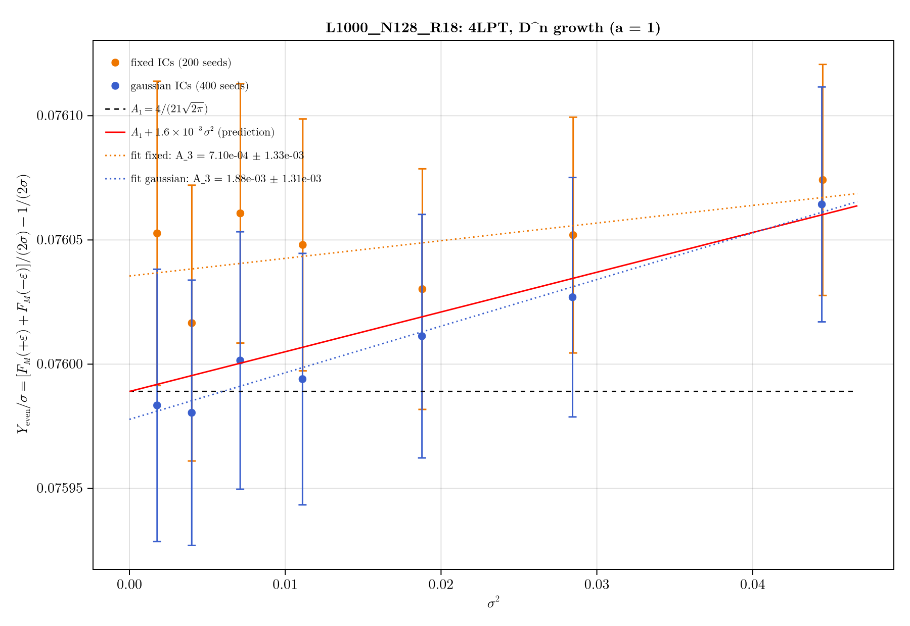

::: {.slide-fig-caption}
**Tested across $1100\,(h^{-1}\mathrm{Gpc})^3$ (`studies/mass_cdf`):** $Y_{\mathrm{odd}}/\sigma = A_1 + A_3\sigma^2$ confirms $A_1^{\mathrm{EdS}} = 0.075984 \pm 0.000054$ ($0.07\%$ precision) and resolves the $0.6\%$ exact-$\Lambda$CDM shift in $D_2/D_1^2$ at $>15\sigma$!
:::
:::

::: {.slide-fig .compact}
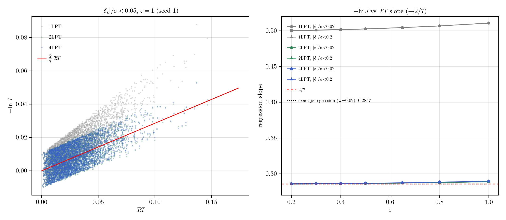
:::
:::
:::

---

## Slide 16: Why 4LPT is Essential for $A_3$ + P1-FEM & PM $N$-Body Validation [Act III · 27:30–29:00]{.act-badge .act-3}

::: {.slide-grid-2}
::: {.slide-col}
::: {.slide-grid-2}
::: {.slide-fig .compact}
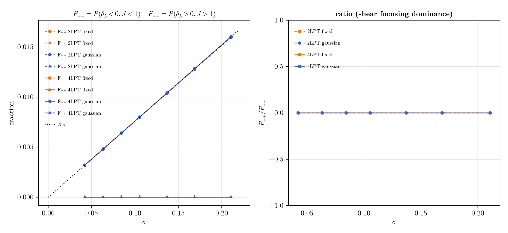

::: {.slide-fig-caption}
**One-way street ($F_{-+} \equiv 0$):** Zero initially overdense elements expand below $\bar\rho$; all $1.6\%$ excess mass comes from $\delta_L < 0$ sheared above $\bar\rho$.
:::
:::

::: {.slide-fig .compact}
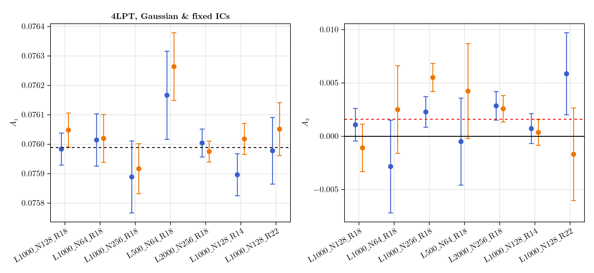

::: {.slide-fig-caption}
**Why 4LPT is required for $A_3$:** 2LPT ($-0.0073$) and 3LPT ($+0.0103$) miss $A_3$; **4LPT converges** to $+0.0021$ (5LPT & 6LPT shift by $<4\times 10^{-5}$).
:::
:::
:::

::: {.slide-card .blue}
[Why Does $A_3$ Require 4LPT?]{.card-heading}


By cumulant counting, every degree-$k$ polynomial part $P_k$ of $-\ln J$ up to $k=4$ enters the $\mathcal{O}(\sigma^3)$ Edgeworth coefficient $A_3$ via $\kappa_4 \sim \langle P_1^3 P_3\rangle + \langle P_1^2 P_2^2\rangle$. Truncating at 2LPT or 3LPT omits the $P_4$ counter-terms!
:::
:::

::: {.slide-card .accent}
[FEM & PM $N$-Body Agreement Down to Small Scales ($R_f = 4\text{–}14\,h^{-1}\mathrm{Mpc}$)]{.card-heading}


- **P1 Finite-Element $N$-Body Check (`disco-dj-fem`):**
  - Evolving the tetrahedral sheet with a P1-FEM Poisson solver and matching the discrete linear operator yields agreement with 4LPT on $F_M(>\bar\rho)$ to **$(3\text{–}4)\times 10^{-5}$ ($0.2\%$ of the nonlinear migration)**!
- **Pushing $R_f$ Down Past First Crossing (`mass_cdf` §16):**
  - At $R_f = 8\,h^{-1}\mathrm{Mpc}$ ($\sigma = 0.49$, $0.14\%$ crossed): $\frac{1}{2} + A_1\sigma + A_3\sigma^3$ matches PM $N$-body within $0.09\%$.
  - At $R_f = 6\,h^{-1}\mathrm{Mpc}$ ($\sigma = 0.58$, $0.9\%$ crossed) and $R_f = 4\,h^{-1}\mathrm{Mpc}$ ($\sigma = 0.78$, $5.2\%$ crossed): the 3-term law still tracks PM $N$-body within **$0.2\%\text{–}0.5\%$**, and the 4LPT void mass fraction $F_M(<0.5\bar\rho)$ agrees with PM $N$-body to **$0.4\%\text{–}1.6\%$**!
:::
:::

---

## Slide 17: Four Structural Advantages for Field-Level Inference [Act IV · 29:00–31:00]{.act-badge .act-4}

::: {.slide-grid-2}
::: {.slide-card .accent}
[1. Zero Shot Noise ($P_{\mathrm{shot}} \equiv 0$) $\Rightarrow$ Smooth HMC Posteriors]{.card-heading}


- No discrete particle counting noise, no artificial empty void cells where $\ln(1+\delta)$ diverges, and no stochastic white-noise floor contaminating high-$k$ modes in the field-level likelihood.

[2. Exact Space–Time Factorization on Lightcones]{.card-heading}


- In PM or COLA, changing $\Omega_m$, $w_0, w_a$, or evaluating a continuous redshift lightcone $z(\chi)$ requires re-running time integration steps.
- In 4LPT, the 13 spatial tensors $\mathbf{S}^\tau(\mathbf{q})$ are computed once from $\delta_0(\mathbf{q})$; evaluating any $a(\chi)$ on a lightcone (`lpt_lightcone` in `DiscoDJ.jl`) is an instant local linear combination!
:::

::: {.slide-card .purple}
[3. Exact Positivity & Mass Conservation by Construction]{.card-heading}


- $1 + \delta(\mathbf{q}, a) = 1/J(\mathbf{q}, a) > 0$ everywhere before shell crossing, and R3D cell clipping preserves $\sum_C \rho_C V_C = M_{\mathrm{tot}}$ to machine precision.
- Furthermore, any local Lagrangian bias expansion $1+\delta_g(\mathbf{q}) = F[\delta_L, T_{ij}T^{ij}, \operatorname{tr}T^3, \nabla^2\delta_L]$ can be carried directly on the tetrahedra!

[4. End-to-End Differentiability (Analytic JVPs & VJPs)]{.card-heading}


- Every stage—initial modes $\delta_0(\mathbf{k}) \to$ 4LPT recursion $\to$ vertex positions $\mathbf{x}_i \to$ continuous Hermite–Genocchi Fourier modes $I_T(\mathbf{k})$—has **exact closed-form derivatives** (`tangent.rs` & `DiscoDJ.jl`).
:::
:::

---

## Slide 18: Exact Analytic Gradients via Confluent Divided Differences [Act IV · 31:00–33:00]{.act-badge .act-4}

::: {.slide-grid-55-45}
::: {.slide-card}
[Differentiating Through 4LPT and Simplex Fourier Modes (`tangent.rs`)]{.card-heading}


- **Step 1 — Tangent LPT Recursion:** Given any initial mode perturbation $\dot{\delta}_0(\mathbf{k})$, forward-mode Jacobian-Vector Products (JVPs) propagate through the bilinear $\mu_2$ and trilinear $\mu_3$ operators via exact Leibniz rules:
  $$\dot{\mu}_2(\mathbf{A}, \mathbf{B}) = \mu_2(\dot{\mathbf{A}}, \mathbf{B}) + \mu_2(\mathbf{A}, \dot{\mathbf{B}}), \qquad \dot{\mathbf{x}}_i = \sum_{n=1}^4 D_n(a)\dot{\boldsymbol{\Psi}}^{(n)}(\mathbf{q}_i)$$
- **Step 2 — Differentiating the Continuous Simplex Mode $I_T(\mathbf{k})$:**
  - How do we differentiate $I_T(\mathbf{k}) = m_T\,d!\,\exp[s_0, \dots, s_d]$ with respect to vertex positions $\dot{\mathbf{x}}_i$ ($\dot{s}_i = -i\mathbf{k}\cdot\dot{\mathbf{x}}_i$) without any grid or finite differences?
  - By the **confluent divided-difference theorem**, differentiating with respect to knot $s_i$ simply repeats $s_i$ as a confluent argument of order $d+1$:
    $$\boxed{\frac{\partial}{\partial s_i}\exp[s_0, \dots, s_d] = \exp[s_0, \dots, s_d, s_i] \implies \dot{I}_T(\mathbf{k}) = m_T\,d!\sum_{i=0}^d \dot{s}_i\,\exp[s_0, \dots, s_d, s_i]}$$
:::

::: {.slide-fig .tall}


::: {.slide-fig-caption}
**Machine-Precision Gradient Verification:** Analytic confluent divided-difference JVP $\partial P_0(k)/\partial A$ matches central finite differences across all wavenumbers without step-size tuning or CIC spline discontinuities.
:::
:::
:::

---

## Slide 19: Baryon Acoustic Oscillations Survive the Nonlinear Sheet Map [Act IV · 33:00–35:00]{.act-badge .act-4}

::: {.slide-grid-45-55}
::: {.slide-card .accent}
[Phase-Matched BAO vs. Smooth No-Wiggle Benchmark]{.card-heading}


- Evolve identical initial random phases with the full oscillating Eisenstein & Hu (1998) BAO transfer function $T_{\mathrm{BAO}}(k)$ and with the smooth no-wiggle transfer function $T_{\mathrm{nw}}(k)$.
- The subtle $\sim 6\%$ acoustic modulation across the first four BAO peaks ($k \in [0.02, 0.30]\,h\,\mathrm{Mpc}^{-1}$) is transported through the 4LPT displacement map, the Kuhn triangulation, and the R3D estimator:
  - **2D ($L = 1000\,h^{-1}\mathrm{Mpc}$, $64^2 \to 128^2$):** Mean BAO modulation error is **$0.47\%$** ($P_0$ sheet) vs. $1.85\%$ (CIC).
  - **3D ($L = 1000\,h^{-1}\mathrm{Mpc}$, $32^3 \to 64^3$):** Mean BAO modulation error is **$0.12\%$** ($P_0$ sheet)—preserving the acoustic ruler without shot-noise corruption!
:::

::: {.slide-fig .tall}


::: {.slide-fig-caption}
**Acoustic peaks carried intact through 4LPT + Sheet Deposition:** Ratio $P_{\mathrm{BAO}}(k)/P_{\mathrm{nw}}(k)$ in 2D and 3D shows the four acoustic peaks preserved cleanly on the continuous sheet.
:::
:::
:::

---

## Slide 20: Live React Panel 4 — BAO Wiggle Ratio & Analytic JVP Inference Explorer [Act IV · 35:00–37:00]{.act-badge .act-4}

```{=html}
<div class="react-slide-lab-mount" data-panel="bao-jvp-inference"></div>
```

---

## Slide 21: Conceptual Synthesis — Where Does the Pre-Crossed Sheet Sit? [Act V · 37:00–38:30]{.act-badge .act-5}

| Aspect | Eulerian PT / EFTofLSS (`LEFTfield`) | Grid LPT / PM + CIC (`BORG`, Shifted-EFT) | **Pre-Crossed Phase-Space Sheet (4LPT + R3D / HG)** |
| :--- | :--- | :--- | :--- |
| **Dynamical Variable** | Eulerian density $\delta(\mathbf{x})$ (breaks as $|\delta|\to 1$) | Discrete point trajectories $\mathbf{x}_p(t)$ | Continuous sheet $\mathbf{x}(\mathbf{q},a) = \mathbf{q}+\boldsymbol{\Psi}$; **exact** $1+\delta = 1/J$ |
| **UV Regularization** | Sharp-$k$ $\Lambda$ + Eulerian counterterms $c_s^2 k^2\delta$ | Grid cutoff + force softening | Initial smoothing $R_f \leftrightarrow \Lambda$ keeping $J(\mathbf{q},a) > 0$ |
| **Voids ($\delta \to -1$)** | Poor (Taylor series in $\delta$ diverges) | Empty cells ($\rho_C = 0$), $\ln(1+\delta)$ diverges | **Exact & strictly positive** ($\rho_T = m_T/V_T > 0$ everywhere) |
| **Shot Noise $P_{\mathrm{shot}}$** | Stochastic counterterm $P_{\epsilon\epsilon} \sim k^0, k^2$ | $L^3/N_p$ white noise floor + $\operatorname{sinc}^{2p}$ window | **Identically zero ($P_{\mathrm{shot}} \equiv 0$)** |
| **1-pt PDFs & Copulas** | Cumulant expansion fails in tails | Noisy in voids; 2LPT has copula residual | **$\lesssim 1\%$ match to $N$-body PDFs**; 4LPT removes 75–95% of 2LPT copula error |
| **Exact Tidal Law $F_M(>\bar\rho)$** | Approximate in $\delta$ | Corrupted by CIC smoothing/discreteness | **Exact parameter-free** $\frac{1}{2} + A_1\sigma + A_3\sigma^3$ to $10^{-4}$ |
| **Differentiability** | Analytic for $n$-pt / grid operators | Adjoint PM + piecewise-linear CIC splines | **Exact analytic JVPs** via confluent divided differences |

::: {.slide-card .accent}
[How This Connects to EFT Bias & Small-Scale Physics]{.card-heading}


The pre-crossed 4LPT sheet serves as the **exact deterministic infrared/mesoscale backbone** (resolving all large-scale displacements, voids, BAO phases, and tidal shear non-perturbatively without shot noise), on top of which UV multi-stream/galaxy bias response functions $\rho_{\mathrm{gal}}(\mathbf{q}) = F[J(\mathbf{q}), T_{ij}T^{ij}(\mathbf{q}), \operatorname{tr}T^3(\mathbf{q})]$ live directly on the Lagrangian tetrahedra!
:::

---

## Slide 22: Summary & Multi-Audience Presentation Hub [Act V · 38:30–40:00]{.act-badge .act-5}

::: {.slide-grid-3}
::: {.slide-card .accent}
[1. The Tessellation Measures What Particles Cannot]{.card-heading}


Connecting vertices into mass-carrying Kuhn simplices eliminates empty void cells ($66.3\% \to 0.0\%$), drives particle shot noise to identically zero ($P_{\mathrm{shot}} \equiv 0$), and yields exact Hermite–Genocchi Fourier modes without grid aliasing.
:::

::: {.slide-card .blue}
[2. Before Shell Crossing, 4LPT is Remarkably Complete]{.card-heading}


At $R_f \sim 14\text{–}18\,h^{-1}\mathrm{Mpc}$ ($\Lambda \sim 0.12\text{–}0.16\,h\,\mathrm{Mpc}^{-1}$, $>99.5\%$ single-stream at $z=0$), 4LPT matches $N$-body 1-pt PDFs to $\lesssim 1\%$, removes 75–95% of 2LPT's 2-pt copula error, and obeys the exact tidal shear focusing law $F_M(>\bar\rho) = \frac{1}{2} + A_1\sigma + A_3\sigma^3$ across $1100\,(h^{-1}\mathrm{Gpc})^3$.
:::

::: {.slide-card .purple}
[3. Ready for Differentiable Field-Level Inference]{.card-heading}


With space–time factorized 4LPT tensors, exact R3D voxelization, confluent divided-difference JVPs, and $0.12\%$ 3D BAO modulation accuracy, the pre-crossed sheet is a fast, noise-free forward model for Stage-IV cosmology.
:::
:::

::: {.slide-card}
[Explore the Live Laboratory, Book & Companion Presentation Tracks]{.card-heading}


- **Full Interactive WebAssembly / WebGPU Laboratory:** [`/app/index.html`](../../app/index.html){target="_blank"} (up to $1024^2$ 2D vertices, Coolwarm $[0.1, 10]$ log density, persistent Trajectory $\times$ Estimator matrix, 3D $\Lambda$CDM benchmarks).
- **Presentations & Audience Summaries Hub:** [`/chapters/08-talks.html`](../../chapters/08-talks.html){target="_blank"} — includes this 40-min EFT/FLI seminar, plus dedicated tracks for **15-min Conference Summary**, **30-min SBI/HMC Inference Workshop**, and **45-min Computational Methods & WebGPU**.
- **Repositories:** [`github.com/yipihey/precrossedsheet`](https://github.com/yipihey/precrossedsheet){target="_blank"} & [`github.com/yipihey/DiscoDJ.jl`](https://github.com/yipihey/DiscoDJ.jl){target="_blank"}
:::
